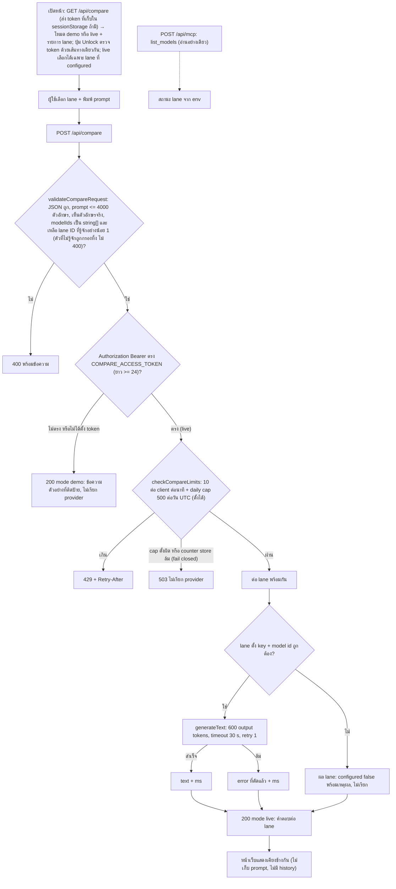
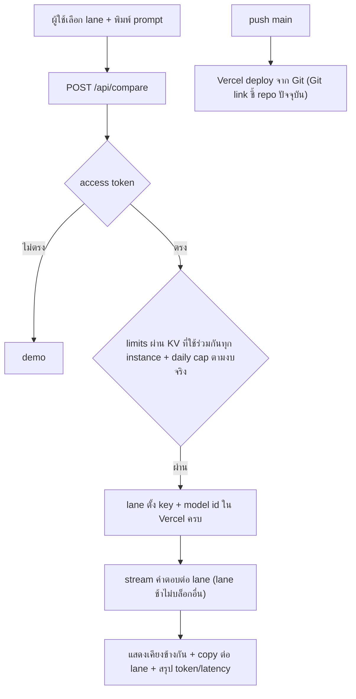

# 01 — Business process (As-Is / To-Be)

ai-chat-playground-web (Model Bench) คือเว็บที่ส่ง prompt เดียวไปยังโมเดลได้สูงสุด 3 lane (OpenAI, Anthropic, Google) แล้วแสดงคำตอบเทียบกัน ผู้ใช้คือ owner (โหมด live ด้วย access token) และผู้เยี่ยมชม portfolio (โหมด demo ที่ไม่เรียก provider)

Last reviewed: 2026-11-28 · commit `6ad9d24`

## As-Is (จากโค้ดวันนี้)

Sources: `app/api/compare/route.ts`, `lib/compareHandler.ts`, `lib/access.ts`, `lib/rateLimit.ts`, `lib/compare.ts`, `lib/models.ts`, `lib/mcp.ts`, `app/page.tsx`, `PRODUCT.md`

ข้อเท็จจริงจากโค้ด/เอกสาร:

- counter ใช้ Upstash/Vercel KV เมื่อมี env ที่เกี่ยวข้อง ไม่เช่นนั้นเป็น memory ต่อ instance (best-effort); ใน production ตั้ง KV แล้วหรือไม่ [ต้องยืนยัน]
- production มี provider key, model id และ `COMPARE_ACCESS_TOKEN` ตั้งไว้หรือไม่ [ต้องยืนยัน] (`PRODUCT.md`: ผู้เยี่ยมชมเห็น demo)
- CI (`ci.yml`) ไม่มีขั้น deploy; deploy เป็นอีกเส้นทางหนึ่ง
- deploy: Vercel project `bookchaowalit-chat-playground-frontend` มี Git link ไป GitHub repo นี้ production branch `main` จึง push เข้า `main` แล้ว deploy (ตรวจผ่าน Vercel API 2026-11-28; owner action D9 ปิดแล้ว) เป็นเส้นทางแยกจาก `ci.yml`; production ตอนนี้ = `main` HEAD b980fcb ซึ่ง deploy ล่าสุดทำผ่าน Vercel CLI
- error ฝั่งเว็บและ server ไป Sentry เมื่อตั้ง `NEXT_PUBLIC_SENTRY_DSN` (ตั้งแล้วตาม `PRODUCT.md`)

## To-Be (`docs/UPGRADE-PLAN.md` §Backlog และ `PRODUCT.md`)

Sources: `docs/UPGRADE-PLAN.md`, `PRODUCT.md`

## Gap

| ID | As-Is → To-Be | Status | Owner | Evidence |
|---|---|---|---|---|
| G1 | ไม่ยืนยันว่า production ตั้ง `COMPARE_ACCESS_TOKEN`, `*_MODEL_ID` และ provider API key → ตั้งใน Vercel พร้อม provider API key ของแต่ละ lane ที่ต้องการเปิด (lane ที่ไม่มี key ยังเป็น `missing-key` และไม่เรียกโมเดล) เพื่อให้ live lane ทำงาน | decide | owner | `docs/UPGRADE-PLAN.md` §P0; `PRODUCT.md` |
| G2 | counter เป็น memory ต่อ instance เมื่อไม่มี KV → provision Upstash/Vercel KV และตั้ง `COMPARE_DAILY_REQUEST_CAP` | todo | owner | `docs/UPGRADE-PLAN.md` §P1; `lib/rateLimit.ts` |
| G3 | คำตอบรอทุก lane แล้วค่อยแสดง (ไม่ stream) → stream ต่อ lane | todo | claude | `docs/UPGRADE-PLAN.md` §P1; `app/api/compare/route.ts` |
| G4 | ยังไม่ยืนยัน canonical domain และ `NEXT_PUBLIC_SITE_URL` → ตั้งค่า | todo | owner | `docs/UPGRADE-PLAN.md` §P1 |
| G5 | ไม่มี copy ต่อ lane และสรุป token/latency → เพิ่ม | todo | claude | `docs/UPGRADE-PLAN.md` §P2 |
| G6 | Vercel Git link ชี้ repo ชื่อเก่า ทำให้ push `main` ไม่ deploy → แก้ link | done | owner | `PRODUCT.md` §Live URL and deploy state (D9); Vercel API 2026-11-28: project `bookchaowalit-chat-playground-frontend` Git link → `bookchaowalit-website/ai-chat-playground-web`, production branch `main` |

## Open questions

- production ตั้ง provider key, model id, access token และ KV แล้วหรือไม่
